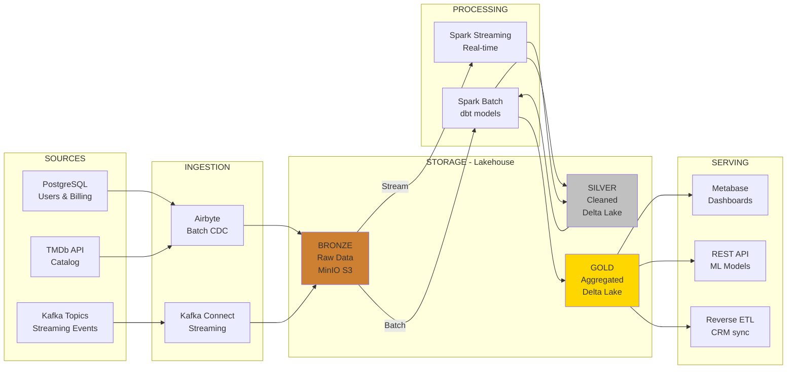

# CineMetrics - Movie Streaming Data Analytics Platform

**Data Engineering Project - University of Brasília (UnB)**

**Team members:**
- [Full Name] - Student ID: [xxxxx]
- [Full Name] - Student ID: [xxxxx]

**Date:** April 2026

---

# Table of Contents

1. [Project Description](#1-project-description)
2. [Data Definition and Classification](#2-data-definition-and-classification)
3. [Domains and Services](#3-domains-and-services)
4. [Architecture - What Will Be Built](#4-architecture---what-will-be-built)
5. [Technologies - How It Will Be Built](#5-technologies---how-it-will-be-built)
6. [Final Considerations](#6-final-considerations)

---

# 1. Project Description

## 1.1. Business Context

CineMetrics is a movie streaming platform (similar to Netflix or Prime Video) that needs to build a robust data infrastructure to support three strategic goals:

1. **User behavior analysis** in real time
2. **Catalog optimization** based on engagement metrics
3. **Personalized recommendation system**

## 1.2. Problem the Project Solves

Streaming companies currently face challenges such as:

- **Fragmented data**: streaming events (play, pause, stop) kept apart from catalog data (movies, actors, genres)
- **Slow decisions**: management reports take days to produce
- **Generic experience**: lack of personalization based on real consumption data
- **Wasted resources**: no clear view of which movies to remove from or add to the catalog

## 1.3. Main Objectives

- **Real time**: executive dashboards refreshed every 5 minutes
- **Consolidated history**: medium/long-term trend analysis (batch)
- **Data-driven**: ground catalog, marketing and product decisions in data
- **Scalability**: support growth from 10 thousand to 100 thousand concurrent users

## 1.4. Stakeholders and End Users

| Stakeholder | Data Needs |
|-------------|---------------------|
| **Product Team** | Engagement metrics (watch time, completion rate, bounce rate) |
| **Marketing** | User segmentation, campaign performance, genre trends |
| **Content/Catalog** | Most-watched and abandoned movies, acquisition recommendations |
| **Executives (C-level)** | Business KPIs (MAU, revenue per user, churn prediction) |
| **Data Scientists** | Clean datasets for ML models (recommendation, churn) |

---

# 2. Data Definition and Classification

## 2.1. Data Sources

### A) Operational Data (Batch)

| Source | Description | Format | Estimated Volume | Frequency |
|-------|-----------|---------|-----------------|------------|
| **Movie Catalog** | Movie metadata (title, genre, duration, year, director, cast) | JSON | ~50 thousand movies | Weekly (new releases) |
| **User Base** | Registration data (ID, name, email, plan, signup_date, country) | CSV | ~100 thousand users | Daily (incremental) |
| **Subscription History** | Financial transactions (subscribed plan, upgrades, cancellations) | Parquet | ~500 thousand records | Daily |
| **Movie Ratings** | Scores and reviews given by users | JSON | ~1 million ratings | Daily |

**Origin**: PostgreSQL transactional database (the platform's operational system)

### B) Streaming Data (Real Time)

| Source | Description | Format | Estimated Volume | Latency |
|-------|-----------|---------|-----------------|----------|
| **Viewing Events** | play, pause, stop, seek, complete | JSON (via Kafka) | ~10 thousand events/minute | < 1 second |
| **Clicks and Navigation** | Movie clicks, search, catalog scrolling | JSON (via Kafka) | ~5 thousand events/minute | < 1 second |
| **Streaming Errors** | Buffering, player failures, video quality | JSON (via Kafka) | ~500 events/minute | < 1 second |

**Origin**: Apps (web, mobile, smart TV) to Apache Kafka

## 2.2. Detailed Classification

### Operational Data (Batch)

**MOVIE CATALOG**
- Origin: External API (TMDb) + internal database
- Format: JSON
- Example structure:
```json
{
  "movie_id": "tt1234567",
  "title": "Inception",
  "release_year": 2010,
  "genres": ["Action", "Sci-Fi", "Thriller"],
  "director": "Christopher Nolan",
  "duration_minutes": 148,
  "rating": "PG-13"
}
```
- Frequency: Weekly update (new releases)
- Volume: ~50 thousand movies (growing ~200/week)

**USER BASE**
- Origin: PostgreSQL (`users` table)
- Format: CSV (daily export)
- Example:
```
user_id,name,email,plan,signup_date,country
U001,Maria Silva,maria@email.com,premium,2024-01-15,BR
```
- Frequency: Daily incremental load (CDC - Change Data Capture)
- Volume: ~100 thousand users (growing ~500/day)

**SUBSCRIPTION HISTORY**
- Origin: Billing system (PostgreSQL)
- Format: Parquet (for storage optimization)
- Frequency: Daily (full snapshot)
- Volume: ~500 thousand transactions (growing ~1.5k/day)

### Streaming Data (Real Time)

**VIEWING EVENTS**
- Origin: Video player (web/mobile/TV) to Kafka Topic: "streaming_events"
- Format: JSON
- Example:
```json
{
  "event_id": "evt_789xyz",
  "user_id": "U001",
  "movie_id": "tt1234567",
  "event_type": "play",
  "timestamp": "2026-04-27T14:32:15Z",
  "device": "mobile_ios",
  "playback_position_seconds": 0,
  "video_quality": "1080p"
}
```
- Latency: < 1 second
- Peak volume: ~10 thousand events/minute (prime time 8pm-11pm)

**NAVIGATION EVENTS**
- Origin: Frontend apps to Kafka Topic: "user_interactions"
- Events: click, search, scroll, add_to_watchlist
- Latency: < 1 second
- Volume: ~5 thousand events/minute

**ERROR EVENTS**
- Origin: Player to Kafka Topic: "streaming_errors"
- Events: buffer_start, playback_failed, quality_drop
- Latency: < 1 second
- Volume: ~500 events/minute (5% of total events)

## 2.3. Classification Summary

| Type | Characteristics | Use Cases |
|------|----------------|--------------|
| **Batch (Operational)** | Structured data, periodic updates, large historical volume | Management reports, trend analysis, traditional BI |
| **Streaming (Events)** | High velocity, low latency, semi-structured (JSON) | Real-time dashboards, alerts, instant recommendations |

---

# 3. Domains and Services

## 3.1. Business Domain Identification

CineMetrics is organized into **4 main domains**:

### Domain: Catalog
**Responsibility**: Management of the movie collection and metadata

**Services**:
- `catalog-management`: Movie CRUD, sync with external APIs (TMDb)
- `metadata-enrichment`: Data enrichment (translations, tags, age rating)
- `content-recommendation-engine`: Similarity-based suggestion generation

### Domain: Users
**Responsibility**: Account management, authentication and profiles

**Services**:
- `user-management`: Sign-up, login, profile updates
- `subscription-billing`: Plan management, payments, upgrades
- `user-segmentation`: Marketing segmentation (churn risk, heavy users, etc.)

### Domain: Streaming
**Responsibility**: Content delivery and quality monitoring

**Services**:
- `video-player-events`: Event capture (play, pause, stop)
- `quality-monitoring`: Monitoring of buffering, errors, latency
- `watch-history`: Storage of viewing history

### Domain: Analytics
**Responsibility**: Generation of insights and business metrics

**Services**:
- `real-time-dashboard`: Live metrics (online users, top movies)
- `batch-reporting`: Management reports (MAU, revenue, churn)
- `ml-pipelines`: Machine learning pipelines (recommendation, churn prediction)

## 3.2. Shared Services (Cross-Domain)

| Service | Responsibility | Used by |
|---------|------------------|-----------|
| **Authentication Service** | Login, JWT tokens, SSO | All domains |
| **Notification Service** | Emails, push notifications | Users, Analytics |
| **Data Lake Storage** | Centralized raw data storage | All domains |
| **Monitoring & Logging** | Observability (Prometheus, Grafana) | All domains |

## 3.3. Domains and Services Diagram

```mermaid
graph TB
    subgraph "Domain: Catalog"
        A1[catalog-management]
        A2[metadata-enrichment]
        A3[content-recommendation]
    end
    
    subgraph "Domain: Users"
        B1[user-management]
        B2[subscription-billing]
        B3[user-segmentation]
    end
    
    subgraph "Domain: Streaming"
        C1[video-player-events]
        C2[quality-monitoring]
        C3[watch-history]
    end
    
    subgraph "Domain: Analytics"
        D1[real-time-dashboard]
        D2[batch-reporting]
        D3[ml-pipelines]
    end
    
    subgraph "Shared Services"
        E1[Authentication]
        E2[Notification]
        E3[Data Lake]
        E4[Monitoring]
    end
    
    A1 --> E3
    B1 --> E1
    C1 --> E3
    D1 --> E3
    D2 --> E3
    D3 --> E3
    
    style A1 fill:#e1f5ff
    style B1 fill:#fff4e1
    style C1 fill:#ffe1f5
    style D1 fill:#e1ffe1
    style E3 fill:#f0f0f0
```



## 3.4. Responsibility Matrix

| Domain | Owned Data | Consumes from | Exposes to |
|---------|----------------|------------|------------|
| **Catalog** | Movies, genres, directors | TMDb API | Streaming, Analytics |
| **Users** | Profiles, subscriptions | - | Streaming, Analytics |
| **Streaming** | Player events | Catalog, Users | Analytics |
| **Analytics** | Aggregated metrics | All domains | Stakeholders (BI) |

---

# 4. Architecture - What Will Be Built

## 4.1. Chosen Architecture Type: LAKEHOUSE

### Why Lakehouse?

We combine the best aspects of a **Data Lake** and a **Data Warehouse**:

| Characteristic | Data Lake | Data Warehouse | **Lakehouse** |
|----------------|-----------|----------------|---------------|
| Data types | Structured + semi + unstructured | Structured only | **All types** |
| Storage cost | Low (object storage) | High (proprietary storage) | **Low** |
| Performance (SQL) | Low | High | **High (Delta Lake)** |
| Schema enforcement | No | Yes | **Yes (optional)** |
| ACID transactions | No | Yes | **Yes** |
| Streaming + Batch | Complex | Hard | **Native** |

**Decision**: We will use **Delta Lake** on MinIO (S3-compatible) to get:
- Cheap storage for raw data (JSON, Parquet)
- ACID transactions for consistency
- Time travel for auditing
- Native support for streaming + batch on the same storage

## 4.2. Medallion Architecture

We will organize the Data Lake into **3 layers**:

**BRONZE (Raw Data)**
- Raw data, no transformation
- Original formats (JSON, CSV)
- Retention: 90 days

**SILVER (Cleaned & Conformed)**
- Clean, deduplicated, validated data
- Schema enforcement
- Format: Parquet with Delta Lake
- Retention: 2 years

**GOLD (Business-Level Aggregates)**
- Tables ready for consumption (BI, ML)
- Pre-computed aggregations
- Format: Parquet with Delta Lake
- Retention: Indefinite

## 4.3. End-to-End Data Flow



## 4.4. Detailed Flows

### BATCH Flow (Operational Data)

**1. EXTRACTION (Daily at 02:00 AM)**
```
PostgreSQL → Airbyte (incremental CDC) → MinIO/bronze/users/*.parquet
```

**2. TRANSFORMATION (Spark Batch)**
- Cleaning: remove duplicates, validate schemas
- Enrichment: joins with the catalog
- Aggregations: daily metrics (DAU, revenue)

**3. LOADING**
```
bronze → silver → gold (Airflow orchestration)
```

**4. CONSUMPTION**
```
Metabase connects to gold.user_metrics (Delta table)
```

### STREAMING Flow (Real-Time Events)

**1. CAPTURE**
```
Player (web/mobile) → Kafka Topic "streaming_events"
```

**2. PROCESSING (Spark Streaming)**
- 5-minute window
- Aggregations: count(play), avg(watch_time) per movie
- Anomaly detection (error spikes)

**3. STORAGE**
```
Kafka → bronze (raw events) → silver (windowed aggregates)
```

**4. CONSUMPTION**
```
Metabase "live" dashboard (refresh 30s)
Alerts (Slack) for critical errors
```

## 4.5. Trade-offs and Rationale

### Coupling
- **Decision**: Loose coupling via Kafka and Object Storage
- **Rationale**: Independent domains, easy to add new consumers
- **Trade-off**: Slightly higher latency vs tight coupling

### Scalability
- **Decision**: Spark cluster (can scale horizontally)
- **Rationale**: Volume can grow 10x without a redesign
- **Trade-off**: Cluster management overhead vs simple scripts

### Availability
- **Decision**: MinIO with replication, Kafka with partitions
- **Rationale**: 99.9% uptime for critical data
- **Trade-off**: Infrastructure cost vs single-node

### Reliability
- **Decision**: Delta Lake (ACID), schema validation, data quality checks
- **Rationale**: Avoid corrupted data in production
- **Trade-off**: Performance vs consistency guarantees

### Reversibility
- **Decision**: Open-source stack, open formats (Parquet)
- **Rationale**: Easy to migrate to AWS/GCP in the future
- **Trade-off**: Self-managed vs managed services

---

# 5. Technologies - How It Will Be Built

## 5.1. Full Stack

```
┌─────────────────────────────────────────────────┐
│          ORCHESTRATION & MONITORING             │
│  Apache Airflow | Prometheus | Grafana          │
└─────────────────────────────────────────────────┘
                        ▲
┌───────────┬───────────┴───────────┬─────────────┐
│ INGESTION │    PROCESSING         │   SERVING   │
├───────────┼───────────────────────┼─────────────┤
│ Airbyte   │ Apache Spark          │ Metabase    │
│ Kafka     │ dbt (Spark backend)   │ FastAPI     │
│           │ Delta Lake            │             │
└───────────┴───────────────────────┴─────────────┘
                        ▲
              ┌─────────┴─────────┐
              │     STORAGE       │
              │  MinIO (S3-like)  │
              │  PostgreSQL (MD)  │
              └───────────────────┘
```

## 5.2. INGESTION

### Apache Kafka (Streaming)
**What it is**: Distributed streaming platform (message broker)

**Why we chose it**:
- Industry standard for real-time events
- High throughput (10k+ msg/s on modest hardware)
- Persistence: events are retained (configurable retention)
- Native integration with Spark Streaming

**Alternatives considered**:
- RabbitMQ: simpler, but lower throughput
- AWS Kinesis: vendor lock-in, high cost for testing

**How we will use it**:
```python
# Producer (frontend application)
from kafka import KafkaProducer
producer = KafkaProducer(bootstrap_servers='localhost:9092')
producer.send('streaming_events', event_json)

# Consumer (Spark Streaming)
streaming_df = spark.readStream \
    .format("kafka") \
    .option("kafka.bootstrap.servers", "localhost:9092") \
    .option("subscribe", "streaming_events") \
    .load()
```

### Airbyte (Batch)
**What it is**: Open-source ELT tool (Extract, Load, Transform)

**Why we chose it**:
- 300+ ready-made connectors (PostgreSQL, APIs, etc.)
- Friendly UI to configure pipelines
- Native Change Data Capture (CDC)
- Local deployment via Docker

**Alternatives considered**:
- Fivetran: paid, no robust free tier
- Custom Python scripts: manual work, no UI

**How we will use it**:
```yaml
# Source configuration (PostgreSQL)
source:
  type: postgres
  host: localhost
  database: cinemetrics_prod
  username: readonly_user
  
# Destination configuration (MinIO)
destination:
  type: s3
  endpoint: http://minio:9000
  bucket: lakehouse-bronze
  format: parquet
```

## 5.3. STORAGE

### MinIO (Object Storage)
**What it is**: S3-compatible storage that runs on-premise

**Why we chose it**:
- API 100% compatible with AWS S3 (easy future migration)
- Free and open-source
- Runs on a laptop (minimum 4GB RAM)
- Enough performance for 100k users

**Alternatives considered**:
- AWS S3: cost for testing, requires a credit card
- Local filesystem: not scalable, no replication features

**How we will use it**:
```python
import boto3

s3 = boto3.client('s3',
    endpoint_url='http://localhost:9000',
    aws_access_key_id='minioadmin',
    aws_secret_access_key='minioadmin'
)

# File upload
s3.upload_file('events.json', 'lakehouse-bronze', 'streaming/2026/04/27/events.json')
```

### Delta Lake
**What it is**: ACID storage layer on top of a Data Lake (Parquet + transaction log)

**Why we chose it**:
- ACID transactions (prevents dirty reads)
- Time travel: `SELECT * FROM table VERSION AS OF 10`
- Schema evolution without breaking pipelines
- Automatic optimizations (Z-ordering, compaction)

**Alternatives considered**:
- Plain Parquet: no ACID, hard to manage updates
- Apache Iceberg: less mature, smaller community

**How we will use it**:
```python
# Write (Spark)
df.write.format("delta").mode("overwrite").save("s3a://lakehouse-silver/users")

# Read with time travel
old_version = spark.read.format("delta") \
    .option("versionAsOf", 5) \
    .load("s3a://lakehouse-silver/users")
```

### PostgreSQL (Metadata & Small Tables)
**Why we still use it**:
- Airflow metadata (DAGs, runs, logs)
- Small lookup tables (countries, genres)
- Feature store for ML (low-latency reads)

## 5.4. PROCESSING AND TRANSFORMATION

### Apache Spark
**What it is**: Distributed processing engine (batch + streaming)

**Why we chose it**:
- Processes batch (historical) and streaming (real-time) with the same API
- Scala + Python (PySpark), accessible for beginners
- Native integration with Delta Lake and Kafka
- Runs locally (standalone mode) or on a cluster

**Alternatives considered**:
- Apache Flink: steeper learning curve
- Pandas: does not scale (limited memory)

**How we will use it**:
```python
# Batch processing
from pyspark.sql import SparkSession

spark = SparkSession.builder \
    .appName("CineMetrics ETL") \
    .config("spark.jars.packages", "io.delta:delta-core_2.12:2.4.0") \
    .getOrCreate()

# Read from bronze
raw_events = spark.read.format("delta").load("s3a://lakehouse-bronze/events")

# Transform
clean_events = raw_events \
    .dropDuplicates(["event_id"]) \
    .filter("event_type IN ('play', 'pause', 'complete')")

# Write to silver
clean_events.write.format("delta").mode("append").save("s3a://lakehouse-silver/events")
```

```python
# Streaming processing
stream = spark.readStream \
    .format("kafka") \
    .option("subscribe", "streaming_events") \
    .load()

aggregated = stream \
    .groupBy(window("timestamp", "5 minutes"), "movie_id") \
    .agg(count("*").alias("play_count"))

query = aggregated.writeStream \
    .format("delta") \
    .outputMode("append") \
    .option("checkpointLocation", "/tmp/checkpoint") \
    .start("s3a://lakehouse-silver/aggregates")
```

### dbt (Data Build Tool)
**What it is**: SQL transformation framework with versioning and tests

**Why we chose it**:
- Turns SQL into DAGs automatically
- Native data quality tests (`not_null`, `unique`, `relationships`)
- Auto-generated documentation
- dbt-spark adapter (runs on Spark)

**How we will use it**:
```sql
-- models/silver/users_cleaned.sql
{{ config(materialized='incremental') }}

SELECT
    user_id,
    LOWER(email) as email,
    plan,
    signup_date,
    country
FROM {{ source('bronze', 'users') }}
WHERE email IS NOT NULL

    AND updated_at > (SELECT MAX(updated_at) FROM {{ this }})

```

```yaml
# schema.yml (tests)
models:
  - name: users_cleaned
    columns:
      - name: user_id
        tests:
          - unique
          - not_null
      - name: email
        tests:
          - not_null
```

## 5.5. ORCHESTRATION

### Apache Airflow
**What it is**: Workflow orchestration platform (DAGs)

**Why we chose it**:
- Industry standard (used by Airbnb, Netflix, etc.)
- Rich UI to monitor pipelines
- Automatic retries, alerts, centralized logs
- Integrations with Spark, dbt, Kafka

**How we will use it**:
```python
from airflow import DAG
from airflow.providers.apache.spark.operators.spark_submit import SparkSubmitOperator
from airflow.operators.bash import BashOperator
from datetime import datetime, timedelta

default_args = {
    'owner': 'data-team',
    'retries': 2,
    'retry_delay': timedelta(minutes=5)
}

with DAG('daily_etl',
         default_args=default_args,
         schedule_interval='0 2 * * *',  # daily at 02:00 AM
         start_date=datetime(2026, 4, 1)) as dag:
    
    # Task 1: Ingestion (Airbyte trigger)
    ingest = BashOperator(
        task_id='ingest_postgres',
        bash_command='airbyte trigger --connection-id abc123'
    )
    
    # Task 2: Transformation (Spark)
    transform = SparkSubmitOperator(
        task_id='transform_to_silver',
        application='/opt/spark/jobs/bronze_to_silver.py',
        conf={'spark.executor.memory': '2g'}
    )
    
    # Task 3: dbt (aggregations)
    dbt_run = BashOperator(
        task_id='dbt_gold_layer',
        bash_command='cd /dbt && dbt run --models gold.*'
    )
    
    ingest >> transform >> dbt_run
```

## 5.6. DATA SERVING / CONSUMPTION

### Metabase
**What it is**: Open-source BI tool

**Why we chose it**:
- Intuitive interface (non-technical stakeholders)
- Native SQL + visual query builder
- Interactive dashboards with filters
- Connects directly to Delta Lake via Spark Thrift Server

**How we will use it**:
```sql
-- Dashboard: Top 10 movies of the week
SELECT
    m.title,
    COUNT(DISTINCT e.user_id) as unique_viewers,
    SUM(e.watch_time_seconds) / 3600 as total_hours
FROM gold.streaming_events e
JOIN gold.movies m ON e.movie_id = m.movie_id
WHERE e.event_date >= CURRENT_DATE - INTERVAL 7 DAYS
GROUP BY m.title
ORDER BY total_hours DESC
LIMIT 10
```

### FastAPI (REST API for ML)
**Why we chose it**:
- Native Python (easy integration with scikit-learn/TensorFlow models)
- High performance (async)
- Auto-generated documentation (Swagger UI)

**How we will use it**:
```python
from fastapi import FastAPI
import joblib

app = FastAPI()
model = joblib.load('models/churn_predictor.pkl')

@app.post("/predict/churn")
def predict_churn(user_id: str):
    features = get_user_features(user_id)  # query Delta Lake
    prediction = model.predict([features])
    return {"user_id": user_id, "churn_risk": float(prediction[0])}
```

## 5.7. LIFECYCLE UNDERCURRENTS

### Security
- **Authentication**: Airflow with LDAP, Metabase with SSO
- **Encryption**: MinIO with TLS, Kafka with SASL/SSL
- **LGPD (Brazilian data protection law)**: PII anonymization in the silver layer (email hashing)

### Data Management
- **Data Catalog**: Apache Atlas (metadata management)
- **Lineage**: dbt docs + Airflow UI (who created each table)
- **Quality**: dbt tests + Great Expectations

### DataOps
- **CI/CD**: GitHub Actions to deploy DAGs and dbt models
- **Versioning**: Git for code, Delta Lake time travel for data
- **Testing**: Pytest for pipelines, dbt tests for schemas

### Monitoring
- **Metrics**: Prometheus (Airflow, Spark, Kafka metrics)
- **Dashboards**: Grafana (infra health, pipeline SLAs)
- **Alerts**: Slack notifications for critical failures

### Governance
- **Ownership**: Each domain has a data owner (via CODEOWNERS in Git)
- **Policies**: Data retention (bronze 90d, silver 2y, gold indefinite)
- **Compliance**: Audit logs on every write (Delta Lake transaction log)

---

# 6. Final Considerations

## 6.1. Main Risks and Limitations

| Risk | Impact | Mitigation |
|-------|---------|-----------|
| **Insufficient hardware** | Spark may hang with <8GB RAM | Test on a sample (10% of the data), use local mode |
| **Initial complexity** | Learning curve (Kafka, Spark, Airflow) | Start with simple POCs, document every step |
| **Streaming latency** | Events may be delayed (network issues) | Configure Kafka retention, monitor lag |
| **Data quality** | Bad data in bronze leads to problems in gold | Implement validations in silver (dbt tests) |
| **Maintenance cost** | Self-managed cluster requires DevOps | Automate with Docker Compose and setup scripts |

## 6.2. Next Steps for Part 2 (Implementation)

### Phase 1: Infrastructure Setup (Weeks 1-2)
- Docker Compose with all services (Kafka, MinIO, Spark, Airflow, Metabase)
- Automatic initialization scripts
- Git repository with a defined folder structure

### Phase 2: Ingestion POC (Weeks 3-4)
- Generate synthetic data (Python script to simulate events)
- Configure the Kafka producer
- Airbyte: connect PostgreSQL to MinIO

### Phase 3: Bronze to Silver Transformations (Weeks 5-6)
- Spark job to clean events
- dbt models for silver tables
- Quality tests (nulls, duplicates)

### Phase 4: Gold Aggregations + Dashboards (Weeks 7-8)
- dbt models for business metrics
- Metabase: 3 main dashboards (real-time, weekly, churn)

### Phase 5: Orchestration + Monitoring (Weeks 9-10)
- Airflow DAGs for automation
- Grafana dashboards for infrastructure
- Final documentation

## 6.3. Minimal Proof of Concept (to validate choices)

**What we will implement BEFORE Part 2:**

```python
# poc_kafka_spark.py - 50 lines
# Goal: Prove that Kafka -> Spark -> Delta Lake works

from pyspark.sql import SparkSession
from kafka import KafkaProducer
import json, time

# 1. Simple producer
producer = KafkaProducer(bootstrap_servers='localhost:9092')
for i in range(100):
    event = {"user_id": f"U{i}", "movie_id": "M1", "event": "play"}
    producer.send('test_events', json.dumps(event).encode())
    time.sleep(0.1)

# 2. Consumer with Spark Streaming
spark = SparkSession.builder.appName("POC").getOrCreate()
df = spark.readStream.format("kafka") \
    .option("kafka.bootstrap.servers", "localhost:9092") \
    .option("subscribe", "test_events").load()

# 3. Write to Delta
query = df.writeStream.format("delta") \
    .option("checkpointLocation", "/tmp/chk") \
    .start("/tmp/delta_poc")

query.awaitTermination(timeout=60)
print("POC worked! 100 events processed")
```

**Expected result**: If it runs without errors, we confirm the stack works.

## 6.4. References

### Books and Articles
1. **Fundamentals of Data Engineering** (Reis & Housley, 2022)
2. **Designing Data-Intensive Applications** (Martin Kleppmann, 2017)
3. **The Data Warehouse Toolkit** (Ralph Kimball, 2013)
4. **Delta Lake: The Definitive Guide** (Databricks, 2023)

### Official Documentation
- Apache Kafka: https://kafka.apache.org/documentation/
- Apache Spark: https://spark.apache.org/docs/latest/
- Delta Lake: https://docs.delta.io/
- dbt: https://docs.getdbt.com/
- Airbyte: https://docs.airbyte.com/

### Tutorials and Courses
- Data Engineering Zoomcamp (DataTalks.Club)
- Spark Streaming Programming Guide
- Kafka The Definitive Guide (O'Reilly)

### Technical Blogs
- Netflix Tech Blog (Data Platform)
- Uber Engineering (Real-time Analytics)
- Databricks Blog (Lakehouse Architecture)

---

**End of Document**
